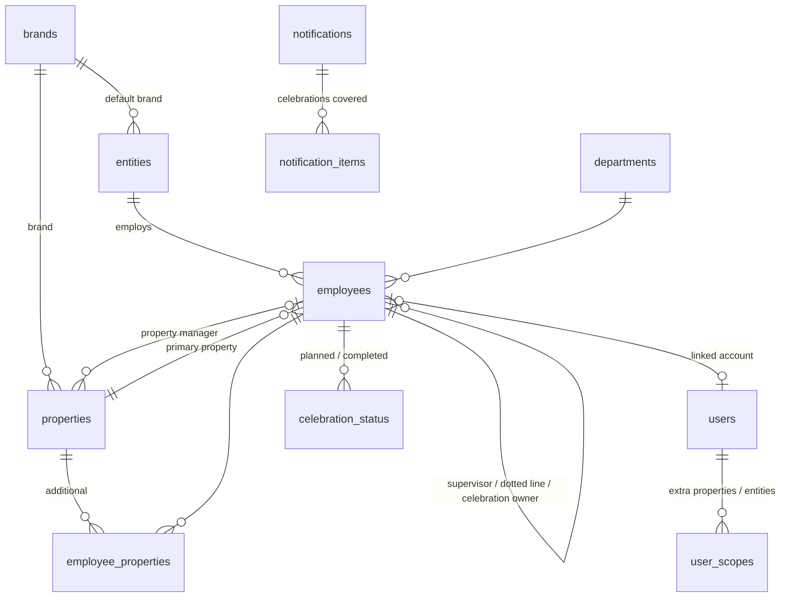

# Dwell Central: architecture and implementation plan

Phase 1 (AIDEN Job #002): the **Administration foundation** and the **Employees module**, built so
the later modules (Entities, Properties, Projects, Resources) plug into the same sign-in, permissions,
records, audit log and notification system.

## 1. Approach

| Decision | Choice | Why |
|---|---|---|
| Platform | PHP 8.1+, MySQL/MariaDB, jQuery, Apache: Dwell's existing Ubuntu 22.04 LAMP server | Matches the server and the team's preferred stack; no new hosting cost |
| Structure | One application, organized in modules (`src/Core`, `src/Org`, `src/Employees`, `src/Celebrations`, `src/Notifications`, `src/Import`) | Simple to deploy and back up; modules share one database, one permission system and one audit log |
| Address | `https://www.58dwell.com/dash/` | A folder of the existing site, like `/book/`; no DNS changes |
| Code location | `/var/www/dwell-central`, with only `public/` linked into the web root | Configuration, source code, logs, photos and backups are never reachable from the web |
| Front end | One page drawn by jQuery from a JSON API; d3 (vendored) for the org chart | No build step; every file is in the repository; no third-party scripts, fonts or trackers |
| Email | PHPMailer (bundled) through Dwell's SMTP account, via an outbox table | Retries, history and "test mode" without extra services |
| Background work | One cron job every 5 minutes (`bin/cron.php`) | Daily celebration check at 8:00 AM Eastern, retries, housekeeping |

## 2. Modules

```
Administration (built)    sign-in, roles & scopes, users, settings, audit log, notifications, imports, health
Organization (built)      companies (brands), legal entities, properties/offices, departments: shared by every module
Employees (built)         records, directory, profiles, org chart, celebrations, celebration emails
Entities (Phase 2)        builds on `entities` (legal details, ownership, documents)
Properties (Phase 3)      builds on `properties` (units, addresses, managers, vendors)
Projects, Resources       new tables linked to the same records, users and permissions
```

A future module adds its tables, a `src/<Module>` folder, its API actions to `src/Api/Router.php`
(each with a permission) and its screens to `public/assets/js`. Sign-in, permissions, the audit log,
the outbox and the organization records are reused, not rebuilt.

## 3. Data model



**Employee record** (`employees`): stable Dwell Central ID (`DC-00042`, never reused) and optional HR ID;
legal first/last name and the name they go by; work email; job title; department; legal employing entity
and affiliated brand; primary property plus additional properties; direct supervisor; optional dotted-line
manager; optional celebration owner override; most recent hire date and original hire date (rehires);
term date; birthday month/day (the **year only if a setting allows it**, off by default) with a status
(`ok` / `needs_review` / `missing`); hire-date status; employment status (active, on leave, former);
celebration preferences; approved photo; internal notes; "verified against HR" timestamp.

Linked records, not free text: company, entity, property and department are IDs into shared tables.
Each shared record keeps the spellings seen in HR files ("also known as"), so `EastGAte`, `750.0` or
`DWELL COMMUNITIES, LLC` match the right record on the next import.

Service years are calculated, never stored. Calendar dates are plain dates in the America/New_York
time zone; timestamps are stored in UTC.

## 4. Security and privacy

This is a private personnel application. Controls:

- **Server-enforced access.** Every API action is listed once in `src/Api/Router.php` with the
  permission it needs; the check runs before the handler. Queries that return people are also filtered
  by `Access::visibleIds()`, so changing an ID in a URL returns "not found". Photos are served by
  `photo.php` with the same checks. The test suite calls every action as a signed-out visitor and as a
  manager to prove it.
- **Roles.**

  | | System administrator | Executive leadership | Property manager / supervisor | Employee (future) |
  |---|---|---|---|---|
  | Who they see | Everyone, incl. former | Everyone, incl. former | Their reporting line, properties they manage or are given, people they're the owner for | Current team |
  | Fields | All, incl. internal notes, HR ID, birth year (if kept) | Celebration dates, owners | Celebration dates, owners | Name, title, property, department, supervisor, photo |
  | Dashboard, calendar | ✓ | ✓ | ✓ (their people) | — |
  | Notification history | ✓ manage | ✓ view | — | — |
  | Edit, import, users, settings, audit | ✓ | — | — | — |

- **Sign-in.** Google Workspace sign-in when approved (OpenID Connect; restricted to Dwell's domain),
  otherwise email + password (bcrypt). Accounts exist only when an administrator creates them; knowing an
  email address grants nothing. Signed HttpOnly cookie scoped to `/dash/`, 7-day sessions; changing a
  password, role or email signs out everywhere. Rate-limited sign-in, CSRF token on every change, strict
  Content-Security-Policy, no third-party scripts.
- **Data minimization.** Birth year off by default: imports use it only to catch impossible dates and
  then discard it; turning the setting off erases stored years. No year of birth or age appears in any
  email, chart, calendar or export. Former employees are not imported unless already on record.
  Uploaded spreadsheets are deleted immediately after reading; their rows are held in the database only
  until the import is applied or discarded.
- **Protected stores.** `config/config.php` (credentials) is outside the web root and ignored by Git;
  photos, logs and backups live in `storage/` (outside the web root, backups owner-only). The audit log
  is visible to system administrators only and records birthday changes as "changed" without values.
- **No personnel data in Git.** `.xlsx`/`.csv` files are ignored; demo data is fictional
  (`tests/seed-demo.php`).

## 5. Org chart

`public/assets/js/orgchart.js` uses d3's tree layout with pan, zoom and animated expand/collapse.
Three views of the same people, each person appearing once:

- **Companies**: Dwell Communities / 58 Place → properties and offices → staff (nested by supervisor).
- **Properties**: every property and office → staff.
- **Reporting lines**: the supervisor hierarchy; people without a supervisor are grouped by property
  under "No reporting line yet" (today, that's everyone, because the HR file has no supervisors).

Cards show photo or initials, name, title, property · department and supervisor. Clicking a person opens
the profile panel; clicking a company or property expands it. Search centers and highlights a person;
filters narrow by company, property and department. The directory, people table and celebrations
calendar use the same data and permissions.

## 6. Spreadsheet import

`src/Import/SpreadsheetReader.php` reads `.xlsx` with PHP's zip + XML extensions (no libraries) or
`.csv`. Two kinds of file are accepted: the **setup workbook** downloaded from the Import page
(`public/assets/templates/Dwell-Central-template.xlsx`: Companies, Legal entities, Properties,
Departments and People sheets, with drop-down lists linking them), and raw HR exports. For the setup
workbook, `src/Import/OrgSheets.php` matches each organization row by name or "also known as"
spelling, plans creates and updates (blank cells never erase), and the People sheet's choices resolve to
those records automatically; property managers, supervisors and dotted-line managers are linked by name
or work email once everyone is known. `src/Import/Importer.php`:

1. Detects the header row and maps columns by name (`Employee Name`, `Client Hire Date`, `Birth`,
   `Division`, `Supervisor`…); unrecognized columns are listed and ignored.
2. Normalizes: ALL-CAPS names, nicknames in quotes or brackets → preferred name, extra spaces, Excel
   date serials, `750.0` → `750`, classification and status words.
3. Validates: birth date after hire date, under 14 at hire, in the future, or over 100 → birthday
   **needs review** (not celebrated); active with a term date, hire dates far in the future or before
   1950, unreadable values → noted.
4. Matches each row to a saved person by HR ID, then work email, then name (legal or preferred).
   Duplicate rows in the file and names matching several saved people need a decision.
5. Compares with the saved record. Blank cells never erase data. Records marked **verified** are
   protected: their changes are listed but only applied when an administrator ticks "Approve changes".
   A file with an earlier hire date than the saved one is flagged as a possibly older copy.
6. Lists current team members missing from the file; they are only marked as former employees if
   ticked.
7. Applies only the plan the administrator reviewed (checked by a hash), in one transaction, with an
   audit entry for every record.

## 7. Celebrations and notifications

Rules are in [POLICIES.md](POLICIES.md). The daily job (`src/Notifications/Notifier.php`) runs at the
configured time (default 8:00 AM America/New_York):

| Message | When | To |
|---|---|---|
| Monthly summary ("October Employee Celebrations - Dwell Communities") | 1st of the month (catches up for 3 days if the server was down) | Each celebration owner, listing only the people they're responsible for; optional "no celebrations" note |
| Organization-wide report | 1st of the month | Executives and administrators who opted in |
| Advance reminder | 3 days before (configurable) | The owner (and dotted-line manager if enabled) |
| Day-of ("Today Is Maria's Birthday!") | The day | Same |
| No-owner alert | When a celebration without a valid owner enters the reminder window | Designated administrators, once per celebration |
| Delivery-failure alert | After 5 failed attempts | Designated administrators, once per failure |

Reliability: every message has an idempotency key (mode + kind + celebration + recipient) stored with a
unique index, and the daily run claims a `job_runs` row, so re-running a day never sends twice.
Failures retry with back-off (5 attempts) and are visible in Notifications with the server's error.
Owners are worked out at send time, so changing a supervisor changes routing immediately.

**Test mode is the default.** Messages are built exactly as in live mode, labelled `[TEST]`, and
delivered only to a chosen system administrator's inbox (or just recorded). "Preview a day" renders
what any date would produce without queueing anything. Switching to **live** requires a system
administrator to type `GO LIVE`; it is audited and shows a readiness checklist first.

Optional follow-through: owners and executives can mark a celebration *Planned*, *Celebrated* or
*Skipped*; email delivery is never treated as proof that anyone celebrated.

## 8. Google integration

See [GOOGLE.md](GOOGLE.md). Google sign-in is implemented and switches on when an OAuth client from a
Dwell-owned Google Cloud project is added to `config.php`. Google Calendar is designed but not built
until approved: the recommendation is a dedicated, Dwell-owned shared calendar written by a service
account that can access only that calendar.

## 9. Stages

| Stage | Status |
|---|---|
| 1. Discovery: source review, data-quality report, architecture, decisions | Done. Data review delivered separately (it names people, so it is not in Git); decisions in [DECISIONS.md](DECISIONS.md) |
| 2. Foundation: database, sign-in, roles and scopes, settings, audit, outbox, cron, health check | Done |
| 3. Visualization and import: org chart, directory, profiles, people records, import with preview/approval | Done |
| 4. Celebrations dashboard: KPIs, calendar with filters, upcoming list with notification status, follow-through | Done |
| 5. Notifications: monthly/advance/day-of/alerts, test mode, preview, history, retries | Done, in test mode until approved |
| 6. Google Calendar | Designed; waiting for approval (Google Cloud project, service account, calendar owner) |
| 7. Testing and deployment | 133 automated acceptance tests (PHP 8.1 and 8.3); deployment and admin guides; deploy to `/dash` once decisions are made |

## 10. Acceptance tests (brief §Acceptance → `tests/run.php`)

| Brief requirement | Covered by |
|---|---|
| Correct birthday and service-year calculations | "Birthday, anniversary and service-year rules" |
| Supervisor-only vs executive views | "Access: server-enforced, per role" |
| Inactive employees excluded | "Former employees and people on leave are excluded" |
| Supervisor reassignment updates routing | "Changing the supervisor changes the owner", "Reassignment updates email routing" |
| Missing owner alerts the admin | "Celebrations without an owner alert the designated administrator" (+ not repeated) |
| Missing dates never invent events | "Missing birthday and hire date never create an event", "needs review" |
| Repeated runs never duplicate; failures logged and retried | "A second run…", "A forced re-run creates no duplicates", failure/retry/alert tests |
| Leap-day and rehire rules | Feb 29 tests, "Rehire: anniversary counts from…" |
| Calendar sync without duplicates | Deferred with Stage 6 (stable event IDs designed in GOOGLE.md) |
| Unauthorized URL/API access blocked | Every action as signed-out and as manager; ID-in-URL test; CSRF test |
| Import cannot silently overwrite validated data | Verified-record protection, stale-plan hash, blank-cell tests |

Run them with `DC_DB_NAME=dwell_test php tests/run.php` (a separate, disposable database).
